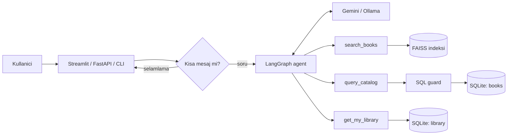

# BookMind

Kullanicinin kisisel kutuphanesine bakarak Turkce kitap onerisi yapan bir LLM agent servisi.

Kullanici "okudugum kitaplara benzer bir roman oner", "150 TL altindaki polisiyeler neler?" ya da
"uzayda gecen karanlik bir hikaye ariyorum" gibi sorular sorar. Agent soruya gore hangi araci
kullanacagina kendisi karar verir: anlamsal arama, katalog uzerinde SQL sorgusu veya kullanicinin
kutuphanesi. Cevaplar sadece katalogdaki kitaplardan uretilir.

## Ozellikler

- **LangGraph agent**: model -> arac -> model dongusu, adim limiti ve kullanici bazli sohbet gecmisi
- **Anlamsal arama (RAG)**: cok dilli `paraphrase-multilingual-MiniLM-L12-v2` embedding modeli ve FAISS
- **Text-to-SQL**: fiyat, yazar, tur, sayma gibi kesin sorular icin modelin yazdigi SQL salt okunur calistirilir
- **Kisisel kutuphane**: okudum / okuyorum / okuyacagim durumlari ve 1-5 puan. Okunan kitaplar tekrar onerilmez
- **Iki LLM secenegi**: Gemini API veya Ollama ile yerelde calisan acik kaynak model (Qwen, Llama, Gemma)
- **Yedek modeller**: Gemini 429/503/504 verirse istek siradaki modele gider; hata veren model 5 dakika atlanir
- **Turkce karakter toleransi**: "siir kitabi" ile "şiir kitabı" ayni sonucu verir, hem aramada hem SQL'de
- **Degerlendirme**: retrieval ve agent icin ayri test setleri, otomatik skor
- Streamlit web arayuzu, FastAPI servisi, komut satiri arayuzu, Docker

## Mimari



| Arac | Ne zaman kullanilir | Ornek |
|---|---|---|
| `search_books` | Konu, tema, atmosfer | "beni motive edecek bir kitap" |
| `query_catalog` | Kesin kosullar, sayma, siralama | "en ucuz 3 bilim kurgu kitabi" |
| `get_my_library` | Kisisellestirme | "okuduklarima gore ne onerirsin" |

Araclar her istekte o kullaniciya ozel olusturulur. Kullanici kimligi modele hic verilmez, bu yuzden
model baska bir kullanicinin kutuphanesine erisemez. Anlamsal arama sonuclarindan kullanicinin
kutuphanesindeki kitaplar otomatik olarak cikarilir.

## Text-to-SQL guvenligi

Modelin urettigi SQL dogrudan calistirilmaz, `bookmind/sql_guard.py` icinden gecer:

1. Sadece tek bir `SELECT` veya `WITH` ifadesine izin verilir.
2. SQLite authorizer ile sadece `books` tablosundan okunabilir. `library` tablosu, `sqlite_master`
   ve yazma islemleri motor seviyesinde engellenir. Ornegin `WITH x AS (SELECT 1) DELETE FROM books`
   gibi metin kontrolunu atlatan bir sorgu da reddedilir.
3. Baglanti salt okunur modda acilir, en fazla 20 satir doner, 2 saniyelik zaman asimi vardir.
4. Hata olursa mesaj modele geri verilir, model sorguyu duzeltip tekrar deneyebilir.

Turkce karakter sorunlari icin SQL'e `norm()` fonksiyonu eklendi: `norm('Ahmet ÜMİT') = 'ahmet umit'`.
Ayrica `LIKE` iki tarafi da sadelestirerek karsilastirir; model `norm(genre) LIKE '%çocuk%'` gibi
tek tarafi sadelestirilmis bir sorgu yazsa da dogru sonuc doner.

Kitap ozetleri prompt injection riski tasiyabilecegi icin sistem talimatinda arac ciktilarinin veri
oldugu, talimat olarak uygulanmayacagi belirtilir.

## Kurulum

Python 3.10 veya ustu gerekir.

```bash
git clone https://github.com/DemetAsgaroglu/bookmind.git
cd bookmind
python -m venv .venv
source .venv/bin/activate        # Windows: .venv\Scripts\activate
pip install -r requirements.txt
cp .env.example .env             # GOOGLE_API_KEY degerini girin
python scripts/build_index.py    # SQLite veritabani ve FAISS indeksi
```

Ilk calistirmada embedding modeli (~470 MB) Hugging Face'ten indirilir.

### Ollama ile yerel model

```bash
ollama pull qwen2.5:7b
```

`.env` icinde `LLM_PROVIDER=ollama` yapmaniz yeterli. Arac cagirma (tool calling) destekleyen bir
model secilmeli; Qwen 2.5 ve Llama 3.1 ailesi destekliyor.

### Gemini ayarlari

| Degisken | Varsayilan | Aciklama |
|---|---|---|
| `GEMINI_MODEL` | `gemini-3.8-flash` | Ana model |
| `GEMINI_FALLBACK_MODELS` | `gemini-3.6-flash,gemini-3.1-flash-lite` | Ana model cevap veremezse sirayla denenir, bos birakilirsa yedek yok |
| `GEMINI_MAX_ATTEMPTS` | `2` | Model basina toplam deneme (gecici hatalarda 1, 2, 4... sn bekler) |
| `GEMINI_TIMEOUT` | `90` | Istek basina sure siniri (sn) |

Butun modeller basarisiz olursa kullaniciya ham hata yerine "model cok yogun" mesaji doner.

## Kullanim

### Komut satiri

```bash
# Arama ve kutuphaneye kitap ekleme
python -m bookmind.cli search "uzayda gecen bir roman"
python -m bookmind.cli library add book_064 --user demet --rating 5
python -m bookmind.cli library add book_020 --user demet --status okuyorum
python -m bookmind.cli library list --user demet

# Sohbet (--debug ile agent'in hangi araci nasil cagirdigi gorunur)
python -m bookmind.cli chat --user demet --debug
```

### Web arayuzu (Streamlit)

```bash
streamlit run streamlit_app.py
```

http://localhost:8501 adresinde sohbet, anlamsal arama ve kisisel kutuphane sekmeleri acilir.
Kullanici kimligi kenar cubugundan secilir.

### API

```bash
uvicorn bookmind.api:app --reload
```

Dokumantasyon: http://localhost:8000/docs

| Metot | Yol | Aciklama |
|---|---|---|
| POST | `/chat` | `{"user_id": "demet", "message": "..."}` |
| DELETE | `/chat/{user_id}` | Sohbet gecmisini sifirlar |
| GET | `/books/search?q=...&limit=5` | Anlamsal arama |
| GET | `/books/{book_id}` | Kitap detayi |
| GET | `/users/{user_id}/library` | Kisisel kutuphane |
| POST | `/users/{user_id}/library` | `{"book_id": "book_064", "status": "okudum", "rating": 5}` |
| DELETE | `/users/{user_id}/library/{book_id}` | Kutuphaneden cikarir |

```bash
curl -X POST localhost:8000/chat -H "Content-Type: application/json" \
  -d '{"user_id": "demet", "message": "Okuduklarima gore bir bilim kurgu oner"}'
```

### Docker

```bash
docker build -t bookmind .
docker run -p 8000:8000 --env-file .env -v bookmind-data:/app/data bookmind
```

Volume, kisisel kutuphane verilerinin konteyner yeniden baslatildiginda kaybolmamasi icin.

## Degerlendirme

```bash
python eval/run_eval.py retrieval   # API anahtari gerekmez
python eval/run_eval.py agent       # .env'deki LLM ile calisir
```

- **Retrieval** (`eval/retrieval_set.json`, 25 sorgu): ilk 5 sonucta beklenen turden kitap var mi
  (Hit@5) ve ilk 5 sonucun ne kadari o turde (Precision@5).
- **Agent** (`eval/agent_set.json`, 18 soru): dogru araci secme orani. SQL gerektiren 10 soruda
  dogru cevap, `gold_sql` sorgusu calistirilarak bulunur ve agent'in cevabinda gecip gecmedigine bakilir.

Sonuclar `eval/results/` altina JSON olarak kaydedilir.

| Olcum | Sonuc |
|---|---|
| Retrieval Hit@5 | %88 (25 sorgu) |
| Retrieval Precision@5 | %57,6 |
| Arac secimi (Gemini 3.1 Flash Lite) | %100 (18/18) |
| SQL cevap dogrulugu (Gemini 3.1 Flash Lite) | %90 (9/10) |

Retrieval test setindeki sorgular bilerek Turkce karakter olmadan yazildi ("siir kitabi"). Embedding
modeli bunlari "şiir kitabı" ile ayni anlamadigi icin arama oncesi kelimeler katalogdan cikarilan
sozlukle duzeltilir (`bookmind/text.py`). Bu adim olmadan ayni sette Hit@5 %52 idi.

Agent olcumu yedek modeller kapali, tek modelle yapildi:
`GEMINI_MODEL=gemini-3.1-flash-lite GEMINI_FALLBACK_MODELS=" " python eval/run_eval.py agent --pause 15`.
Kota veya yogunluk hatasi alan sorular skora katilmaz, `api_errors` olarak ayrica kaydedilir.

## Testler

```bash
pip install -r requirements-dev.txt
pytest
```

Testler embedding modeli ve LLM olmadan calisir: basit bir kelime-torbasi embedder ve onceden
belirlenmis cevaplar donduren sahte bir model kullanilir. SQL guard, kutuphane, kullanici izolasyonu,
agent akisi ve API uc noktalari test edilir.

## Proje yapisi

```text
bookmind/
  agent.py         LangGraph agent, sistem talimati, kullanici bazli bellek
  tools.py         search_books, query_catalog, get_my_library
  sql_guard.py     Text-to-SQL icin dogrulama ve salt okunur calistirma
  vector_store.py  Embedding ve FAISS indeksi
  database.py      SQLite: katalog ve kisisel kutuphane
  rules.py         Selamlama gibi kisa mesajlar icin hazir cevaplar
  llm.py           Gemini / Ollama secimi
  api.py           FastAPI
  cli.py           Komut satiri
streamlit_app.py   Streamlit web arayuzu
scripts/
  fetch_books.py   Google Books API'den veri toplama
  clean_data.py    Tekrarlari birlestirme, kisa aciklamalari eleme
  build_index.py   SQLite ve FAISS indeksini olusturma
eval/              Test setleri ve degerlendirme betigi
tests/             Birim ve entegrasyon testleri
data/              Ham ve temizlenmis katalog (536 kitap)
```

## Veri

Katalog Google Books API'den Turkce aciklamasi olan kitaplarla olusturuldu (`scripts/fetch_books.py`).
Temizlik sonrasi 536 kitap kaldi. Fiyatlar ornek veri olarak rastgele atanmistir.

## Gecmis

Proje ilk olarak 2026'da bir hackathon icin ASP.NET Core web arayuzu ve Firebase ile birlikte
gelistirildi. Bu surumde web arayuzu ve Firebase bagimliligi kaldirildi; kisisel kutuphane SQLite'a
tasindi, tek adimli RAG akisi arac kullanan bir agent'a donusturuldu, Text-to-SQL, FAISS,
degerlendirme ve testler eklendi. Ilk surumun demosu:
[Hugging Face Spaces](https://huggingface.co/spaces/DemetAsgaroglu/bookmind-ai).
